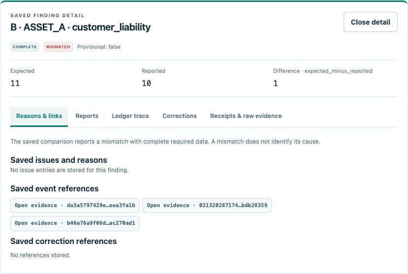
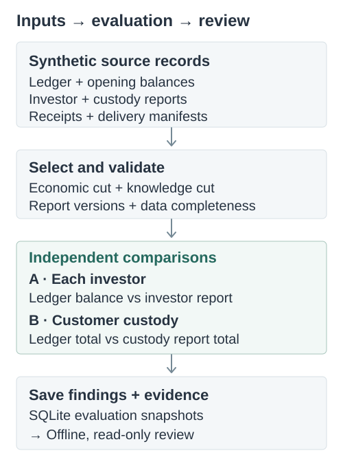

# crypto-reconciliation-lab

Personal project by Ümit Bora Günaydın

I built this project to study reconciliation when records arrive late or are corrected after an evaluation. It uses synthetic ledger, investor and custody data, and keeps earlier findings available for inspection.

Python and SQLite · Package **0.8.0** · Financial rule `stage2-v2` · SQLite schema `5`

[Example](#example) · [Run locally](#run-locally) · [Design notes](docs/model_contract.md) · [Türkçe](docs/showcase/README.tr.md)

## Why I built this

A difference in amounts is only part of a reconciliation result. I wanted to examine how late records, incomplete deliveries and historical corrections change what can reasonably be concluded from the available data.

I kept the implementation local and synthetic so that these cases can be reproduced, inspected and tested without customer data or institutional access. The result includes a financial calculation, an explicit statement of data completeness and references to the records used.

## Example

In `custody_difference / initial / ASSET_A`, the two investor reports agree with the ledger. The customer custody reports do not cover the ledger-derived liability. Both comparisons have complete inputs at the selected cuts.


The **+1** is a discrepancy to investigate. It does not establish a cause, prove a loss or imply insolvency. B uses the sum of **ledger-derived balances**; agreement in investor reports cannot substitute for that calculation. Assets are evaluated separately, with no cross-asset offsetting.

### Inspect the saved finding

The image below is captured from the existing offline reviewer after running the small reproduction. It shows the saved ASSET_A custody finding and links to its event evidence; it is not a proposed interface.



The [asset and capture record](docs/showcase/assets-manifest.json) identifies the screenshot source, run and capture settings. The reviewer reads saved results without recalculating historical balances. Use [Run locally](#run-locally) to open the interactive file on your computer; GitHub displays the image and HTML source, not a hosted application.

## How it works



`occurred_at` locates an economic event; `received_at` records when it became known. `balance_at` selects the balance being compared, while `knowledge_at` limits the information available to that evaluation. Report selection uses the highest valid report version known at that cut for the exact balance time.

In the separate `late_event` demo, the balance cut stays **2026-11-10 23:59:59 UTC**. At knowledge time **2026-11-11 01:00 UTC**, a missing withdrawal leaves a provisional liability comparison of **12 vs 11**, with `INCOMPLETE / NOT_EVALUATED`. At **03:00 UTC**, the withdrawal is known and a new evaluation gives **11 vs 11**, `COMPLETE / MATCHED`. The earlier saved evaluation remains available. These are knowledge cuts, not the withdrawal's occurrence time.

Historical corrections use full `VOID` or amount-only `REPLACE` at the original event's economic position. Investor and custody reports remain independent: a correction does not create or revise either report. Each changes only when its own valid new version is received.

## Engineering decisions

| Decision | Why I chose it; what it does not establish |
|---|---|
| Exact `Decimal` quantities | Preserve decimal amounts without silent rounding. Each asset has its own precision and is reconciled separately; no prices or currency conversions are introduced. |
| Completeness before a verdict | Required delivery manifests and valid record coverage determine whether comparison is justified. Missing data yields `INCOMPLETE / NOT_EVALUATED`; a visible partial difference stays provisional. |
| Economic time and knowledge time | Separate when an event affects a balance from when an evaluation could know it. Synthetic timestamps are input assertions, not authenticated ingestion clocks. |
| Preserved source records and saved history | Keep earlier reports, receipts and evaluations inspectable after later information arrives. SQLite mutation guards are not protection against an adversarial database owner. |
| Independent A/B comparisons | Compare each investor with their report and ledger-derived total liability with customer custody. A matching investor report cannot hide a custody difference. |
| Offline, read-only review | Inspect saved findings and follow evidence references without migrating sources or recalculating their historical results. The viewer is not a correction or payment workflow. |

The [model contract](docs/model_contract.md) defines the equations and selection rules; [correction semantics](docs/correction_semantics.md) explains atomic corrections and independent report versions. The [five-minute review](docs/stage6/five-minute-review.md) provides a shorter route through the implementation and its historical measurements.

## Run locally

With **Python 3.12 or later**, use a new output directory for every run:

```sh
git clone https://github.com/umitbora55/crypto-reconciliation-lab.git
cd crypto-reconciliation-lab
python3 scripts/reproduce_review.py --output review-output-new
```

Open `review-output-new/index.md`, then `review-output-new/review/bundle/index.html`.

This produces **9 synthetic scenarios / 24 saved evaluations**, an offline export, a limited ranking with the existing JSON model and a negative check for contradictory future-source input. Core execution uses the Python standard library; no API key, customer data or institution connection is required. It does not regenerate, train or final-evaluate the frozen main experiment.

Expected synthetic `MISMATCH` and `INCOMPLETE` findings are not application failures. The reproduction exits 0 only when its checks pass. Its deliberately invalid rank must exit 2 and publish no queue; an unexpected subprocess exit or incomplete output fails the reproduction.

## Verification

Stage 10 adds an opt-in source admission boundary. In a newly protected local
database, each new receipt from the public ingestion path is committed with the
authorized publisher, exact signed file and policy epoch that permitted it. A
rejected request cannot reserve or block a legitimate stream. Revocation stops
new effects while previously committed receipts remain available through exact
historical replay; another authorized key for the same publisher can resume.

I kept source authority separate from financial correctness: the signed wrong
custody example still produces MISMATCH. The bounded experiment includes real
SIGKILL barriers, policy rotation and independent evidence mutations. Its trust
anchor and keys are explicitly TEST-ONLY. See the [usage](docs/stage10/usage.md),
[admission boundary](docs/stage10/admission.md), [signing profile](docs/stage10/signing.md)
and [fixed experiment](docs/stage10/experiment.md).

```sh
python3 -m venv .venv-auth
.venv-auth/bin/python -m pip install '.[auth]'
.venv-auth/bin/python -m crypto_reconciliation_lab demo-source-auth --output auth-demo-new --seed 19
.venv-auth/bin/python -m crypto_reconciliation_lab verify-source-auth --bundle auth-demo-new --anchor demo-test-only
```

Auth is optional and does not require NumPy, SciPy or sklearn. Core installation
remains standard-library-only. The local operator, selected policy, database owner
and Python process are trusted. This is not external institutional identity
certification, clock attestation or protection against storage rollback.

Stage 9 adds [restartable finite JSONL admission](docs/stage9/admission-contract.md):
an immutable input plan, exact delivery identities and a committed attempt history.
Run `python3 -m crypto_reconciliation_lab demo-recovery --output recovery-output-new --seed 19`
to inspect the fixed process-crash and replay experiment. ACK records a durable
delivery result; it does not assert financial validity or MATCHED. See the
[recovery report](docs/stage9/recovery-report.md) and [decisions](docs/stage9/decisions.md).
Stage 9.1 preserves malformed-frame rejection diagnostics with escaped Unicode
and requires independent per-scenario work and evidence in the recovery v2 gate.
See the [maintenance handoff](docs/stage9_1/HANDOFF.md) for the two repairs,
same-test RED/GREEN evidence, fixture exceptions and unchanged financial contracts.
The Stage 8 diagrams, real screenshot and Turkish account remain the historical
0.6.1 showcase; their financial example is unchanged.

The **0.6.1** source at [commit 80d3f87](https://github.com/umitbora55/crypto-reconciliation-lab/commit/80d3f87a2fe397eebb67490bb7fa943b6c487719) passed [run 43445168309](https://github.com/umitbora55/crypto-reconciliation-lab/actions/runs/43445168309) on **13 November 2026**. This is the dated baseline evidence, not a claim about a later documentation commit.

| Scope in that run | Verified result |
|---|---|
| Python 3.12 and 3.14 full jobs | 400 fixed test identities in 34 test/fixture files; each source and isolated installed suite discovered and executed every expected ID once, with zero skips/xfails/errors/failures |
| Financial matrix, Python 3.14 | 69 cases / 162 evaluations; all ten named integer error counters zero |
| Complete financial comparison | 325 matrix + 12 Stage 1 + 36 Stage 2 = 373 required files equal to the fixed reference; Python 3.12 compares the 48 demo reports and leaves its unrequested matrix `NOT_RUN` |
| Separate core/no-AI job | Clean wheel installation without sklearn/NumPy/SciPy; demo, export, fixed JSON ranking and negative-input checks passed |

These checks establish a defined verification scope, not capacity or an SLA. The [workflow page](https://github.com/umitbora55/crypto-reconciliation-lab/actions/workflows/release.yml) shows subsequent runs. The [claim–evidence table](docs/stage6/claim-evidence.md) preserves earlier measurements under their original release identities; historical `NOT_RUN` statements remain historical.

<details>
<summary>Build and verification commands</summary>

```sh
python3 -m venv .venv-release
.venv-release/bin/python -m pip install -r requirements-build.txt
.venv-release/bin/python scripts/verify_release.py --profile full --financial --output release-check-new
.venv-release/bin/python scripts/verify_release.py --profile core --output core-check-new
.venv-release/bin/python scripts/verify_release.py --profile auth-only --output auth-check-new
```

The verifier builds an allowlisted source distribution, safely extracts it, and builds the wheel from that extraction. Installed tests use an outside working directory, `-I` and actual site-packages imports. Fixed test and financial contracts reject incomplete coverage before expensive work. Initial builds may download pinned dependencies; installed core operation is offline.

See the [release guide](docs/stage6_1/release-guide.md) and [scope contract](docs/stage6_1/scope-contract.md). Independent wheel builds are not claimed to be byte-identical.

</details>

## AI experiment

I compared one fixed model with FIFO and simple rules for prioritizing synthetic unresolved cases. Historical model-minus-rules recall was **0 percentage points on test** and **−2.083 on challenge**: the experiment demonstrated no additional model benefit.

That result is retained in the [historical evaluation](docs/stage6/evidence/stage5-evaluation.md) and [model card](docs/stage6/evidence/stage5-model_card.md). Ranking does not change financial balances or reconciliation verdicts, and its scores are not calibrated financial risk. The small reproduction replays an existing model on a declared subset; it supplies no new model-success metric and does not reopen the final holdout.

## Limitations

This is a synthetic reference project, not an official KVMKS client, live institutional integration, compliance certificate or production-system claim. It is not evidence of a current institutional deficiency. The [source register](docs/problem_evidence.md) separates documented concepts and dates from prototype assumptions.

Input times and delivery manifests remain synthetic source assertions. Optional
signed admission verifies a key against an operator-selected local policy; it does
not establish institutional identity or financial truth. Preserved SQLite history
does not provide adversarial tamper protection. The named process-kill checks cover
defined local transaction boundaries, not disk/power loss, production capacity or
broad operating-system support.

[MIT license](LICENSE) · [Türkçe anlatım](docs/showcase/README.tr.md)
