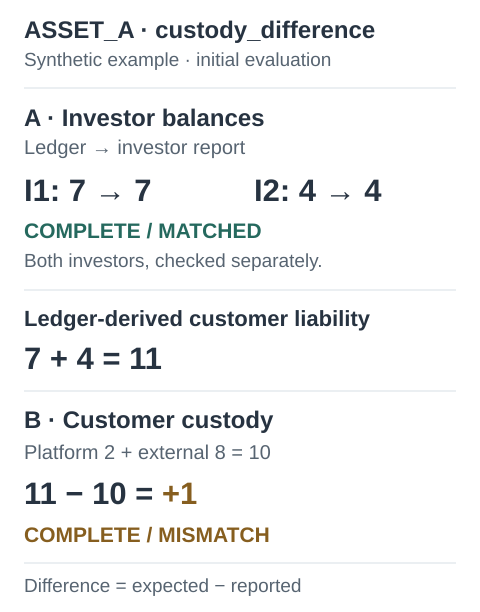
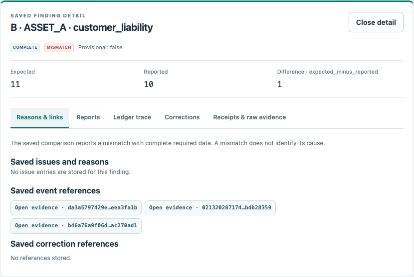

# crypto-reconciliation-lab

Personal project by Ümit Bora Günaydın

I built this project to study reconciliation when records arrive late or are corrected after an evaluation. It uses synthetic ledger, investor and custody data, and keeps earlier findings available for inspection.

Python **3.12+** · Package **0.11.1** · Financial rule `stage2-v2` · SQLite schema `6`

[Example](#example) · [Run locally](#run-locally) · [Five-minute review](docs/stage13_1/five-minute-project-review.md) · [Evidence](#verification) · [Türkçe](docs/stage13_1/project-overview.tr.md)

## Why I built this

A difference in amounts is only part of a reconciliation result. I wanted to examine how late records, incomplete deliveries and historical corrections change what can reasonably be concluded from the available data. I kept the implementation local and synthetic so that these cases can be inspected without customer data or institutional access.

## Example

In `custody_difference / initial / ASSET_A`, comparison **A** agrees with both investor reports: **I1 = 7, I2 = 4**. Their ledger-derived customer liability is **11**. Comparison **B** sees **2** held for customers by the platform and **8** at the external custodian: **10** in total. With complete inputs, B is `COMPLETE / MISMATCH`: expected minus reported is **+1**.



The +1 is a discrepancy to investigate. It does not establish a cause, prove a loss or imply insolvency. B uses **ledger-derived balances**; matching investor reports cannot replace that calculation. Assets never offset one another, and platform customer custody is separate from the platform's own assets.

Incomplete information changes the verdict. In `late_event`, a manifest exposes a missing withdrawal: the visible **12 vs 11** remains `INCOMPLETE / NOT_EVALUATED`. Once the withdrawal is known, a new evaluation gives **11 vs 11**, `COMPLETE / MATCHED`. The earlier result stays available.

### Inspect the saved finding



This is a real **0.6.1 historical capture**, showing the same preserved financial example, not a new 0.11.1 screenshot. The [capture record](docs/showcase/assets-manifest.json) identifies its source and settings. The case diagram explains this example, not the architecture of every later feature.

## How it works

I kept financial calculation, delivery acceptance and evidence claims separate:

| Capability | Decision and contract |
|---|---|
| Exact amounts and time selection | `Decimal`, per-asset precision and zero tolerance; economic time and knowledge time select eligible records. [Model](docs/model_contract.md) |
| Corrections and history | Full `VOID` or amount-only `REPLACE` at the original economic position; reports keep independent versions. [Semantics](docs/correction_semantics.md) |
| Redelivery and interruption | Finite JSONL delivery, committed attempts and retries; an ACK is not a financial verdict. [Admission](docs/stage9/admission-contract.md) |
| Optional signed acceptance | Bind accepted bytes to a publisher key under local policy; revocation controls new effects. [Boundary](docs/stage10/admission.md) |
| Recorded execution context | Save the observed inputs and admission context with the calculation; older unrecorded context remains `NOT_RECORDED`. [Execution](docs/stage12/execution-contract.md) |
| Offline review | Read saved findings and follow their evidence without recalculating balances. [Provenance](docs/stage11/provenance-contract.md) |
| Financial replay | Recalculate from two exported files, compare the complete result, and require a separately selected execution identity. [Replay](docs/stage13/replay-contract.md) |

`occurred_at` is economic time; `received_at` is when a record became known. `balance_at` names the balance cut; `knowledge_at` limits available knowledge. Different balance cuts are not compared as if simultaneous. Completeness is checked before issuing a definitive financial verdict.

## Run locally

From a checkout's project root, with Python 3.12+, run these existing commands. Both output directories must be new:

```sh
python3 scripts/reproduce_review.py --output review-final-new
python3 -m crypto_reconciliation_lab demo-execution-replay --output replay-final-new
```

Open `review-final-new/index.md`, then `review-final-new/review/bundle/index.html`. The first command produces **9 scenarios / 24 saved evaluations**, the offline viewer and limited scoring with the existing JSON model. It needs no API key or optional AI/auth packages; it does not generate, train or final-evaluate the frozen experiment. Expected financial mismatches are not application failures: the outer command exits 0 when its checks pass.

Read `replay-final-new/summary.md` for **seven fixed replay cases**. A correctly reproduced financial mismatch is `REPRODUCED / 0`; a consistently rehashed wrong answer is `DIVERGED / 1`; a wrong external identity is `ERROR / 2`. The demo itself exits 0 when all expected outcomes agree.

The [five-minute review](docs/stage13_1/five-minute-project-review.md) connects these outputs, actual viewer controls and the two replay input files. The viewer reads a saved answer; replay calculates again with the current engine. Five minutes is a reading target, not a promise about setup or CI duration.

## Verification

The application baseline on **15 November 2026** is [commit b2df4f1](https://github.com/umitbora55/crypto-reconciliation-lab/commit/b2df4f13eb7e2fc6b048f17eaaa24f02bf0bd29e), verified by [main CI run 43741674664](https://github.com/umitbora55/crypto-reconciliation-lab/actions/runs/43741674664). Its five jobs succeeded. This dated evidence is not the CI result of a later documentation commit.

| Scope in that run | Result |
|---|---|
| Full Python 3.12 and 3.14 | Each source and isolated installed suite: **875** expected = discovered = executed unique IDs; zero skips, xfails, failures or errors |
| Full Python 3.14 financial check | **69 cases / 162 evaluations**; ten error counters zero; **325 + 12 + 36 = 373** reference files equal |
| Core / auth-only Python 3.14 | Profile checks passed; core has no AI/auth crypto, auth-only has no AI; full suites `NOT_RUN` |
| Other financial matrix cells | `NOT_RUN` |

Four original artifact ZIPs and five job logs were checked at closure. Financial evidence includes recorded fingerprints and command results; compact artifacts do not contain all 373 raw reports. See the [workflow](https://github.com/umitbora55/crypto-reconciliation-lab/actions/workflows/release.yml), [release guide](docs/stage6_1/release-guide.md) and [replay repair contract](docs/stage13_1/repair-contract.md) for engineering detail.

## AI experiment

I compared a fixed model with FIFO and simple rules for prioritizing synthetic unresolved cases. Historical model-minus-rules recall was **0 percentage points on test** and **−2.083 on challenge**: no model advantage was demonstrated. The [evaluation](docs/stage6/evidence/stage5-evaluation.md) and [model card](docs/stage6/evidence/stage5-model_card.md) retain that result. Ranking changes neither balances nor verdicts; the small JSON-model replay supplies no new success metric or holdout evaluation.

## Limitations

Replay uses the current financial engine, not an independent algorithm. Original executable identity is `NOT_RECORDED`; replay does not re-establish source signatures or external completeness of the original database. The expected execution ID is an operator-selected pin, not automatically a trusted institutional identity.

Signed acceptance authorizes a key under local policy. It proves neither real institution identity, reported amount correctness nor regulatory compliance. Real process-kill checks cover named local transaction boundaries, not disk/power-loss guarantees, production capacity or an SLA.

This is a synthetic reference project, not an official KVMKS client or live integration, and not evidence of a current institutional deficiency. The [source register](docs/problem_evidence.md) separates documented concepts from design assumptions.

[MIT license](LICENSE) · [Current Turkish account](docs/stage13_1/project-overview.tr.md) · [Historical 0.6.1 showcase](docs/showcase/README.tr.md)
