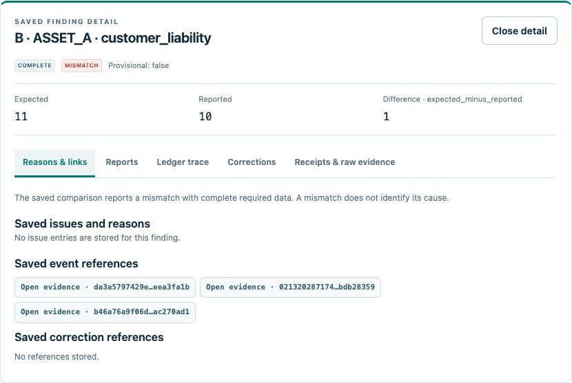

# crypto-reconciliation-lab

Ümit Bora Günaydın'ın kişisel projesi

Bu projeyi, geç gelen kayıtların ve bir değerlendirmeden sonra yapılan düzeltmelerin finansal mutabakatı nasıl etkilediğini incelemek için geliştirdim. Sentetik işlem defteri, yatırımcı ve saklama verileri kullanıyor; önceki bulguları daha sonra da incelenebilir biçimde koruyor.

Python ve SQLite · Paket **0.6.1** · Finansal kural `stage2-v2` · SQLite şema `3`

[Örnek](#örnek) · [Yerelde çalıştırma](#yerelde-çalıştırma) · [Model sözleşmesi](../model_contract.md) · [English](../../README.md)

## Neden geliştirdim?

Mutabakatta yalnız iki miktarın farkını bulmak yeterli değil. Eksik teslimat, geç ulaşan bir işlem veya geçmiş bir kayda yapılan düzeltme, görünen farkın nasıl yorumlanabileceğini değiştiriyor. Hangi kayıtların bilindiğini ve neden bir karşılaştırma yapıldığını —ya da yapılamadığını— açıklayabilen bir örnek üzerinde çalışmak istedim.

Bu davranışları müşteri verisi veya kurum erişimi gerektirmeyen, yerelde tekrar üretilebilen bir Python uygulamasında ele aldım. Sonuç, miktar hesabıyla birlikte veri tamlığını ve kullanılan kayıtların referanslarını da içeriyor.

## Örnek

`custody_difference / initial / ASSET_A` örneğinde yatırımcı raporları işlem defteriyle eşleşiyor. Saklama raporlarının toplamı ise defterden hesaplanan müşteri yükümlülüğünü karşılamıyor. Her iki karşılaştırmanın gerekli girdileri seçilen zaman kesitleri için tam.


Şemadaki **A**, yatırımcı bazındaki karşılaştırma: I1 için 7 ile 7, I2 için 4 ile 4 eşleşiyor. **B** ise toplam müşteri yükümlülüğünü müşteriler adına saklanan varlıklarla karşılaştırıyor: **11 − (2 + 8) = +1**. Buradaki platform saklaması, platformun öz varlıkları değil, müşterileri adına tuttuğu varlıklar.

Bu fark inceleme gerektiren bir uyuşmazlık. Tek başına zarar, iflas, dolandırıcılık veya belirlenmiş bir kök neden kanıtı değil. B hesabında yatırımcıların bildirilmiş bakiyeleri değil, **işlem defterinden hesaplanan bakiyelerin toplamı** kullanılıyor. Farklı varlıkların farkları birbirini kapatmıyor.

### Kaydedilmiş bulguyu inceleme

Aşağıdaki görüntü, küçük örnekler gerçekten çalıştırıldıktan sonra mevcut çevrimdışı inceleme ekranından alındı. ASSET_A saklama bulgusunu ve dayandığı işlem kanıtlarına giden bağlantıları gösteriyor; önerilen bir arayüz çizimi değil.



[Görsel ve çekim kaydı](assets-manifest.json), kullanılan HTML dosyasını, değerlendirme kimliğini ve çekim ayarlarını belirtiyor. İnceleyici, kayıtlı sonuçları okuyor; geçmiş bakiyeleri yeniden hesaplamıyor. Etkileşimli dosyayı kendi bilgisayarınızda açmak için [yerelde çalıştırma](#yerelde-çalıştırma) adımlarını kullanabilirsiniz. GitHub'daki görüntü ve HTML kaynağı, barındırılan bir web uygulaması anlamına gelmiyor.

## Nasıl çalışıyor?


Önce kaynak mesajlar doğrulanıyor ve alındıkları kayıtlarla birlikte saklanıyor. `occurred_at`, işlemin ekonomik zamanını; `received_at`, sistemin o kaydı öğrendiği zamanı belirtiyor. `balance_at`, karşılaştırılan bakiyenin anı; `knowledge_at` ise değerlendirmede kullanılabilecek bilginin sınırı. Raporlarda, tam aynı bakiye anı için o bilgi kesitinde bilinen en yüksek geçerli rapor sürümü seçiliyor.

Ayrı bir örnek olan `late_event` senaryosunda bakiye kesiti **10 Kasım 2026 23:59:59 UTC** olarak sabit. **11 Kasım 01:00 UTC** bilgi kesitinde çekim kaydı henüz gelmediği için yükümlülük karşılaştırmasında geçici olarak **12 ile 11** görülüyor; durum `INCOMPLETE / NOT_EVALUATED`. **03:00 UTC** bilgi kesitinde çekim artık biliniyor ve yeni değerlendirme **11 ile 11**, `COMPLETE / MATCHED` sonucunu veriyor. İlk değerlendirme korunuyor. Bu saatler çekimin gerçekleşme zamanı değil, bilginin değerlendirmeye dahil edildiği kesitler.

Geçmiş işlem düzeltmeleri tam `VOID` veya yalnız miktarı değiştiren `REPLACE` biçiminde destekleniyor ve özgün işlemin ekonomik sırasına uygulanıyor. İşlem düzeltmesi yatırımcı ya da saklama raporunu kendiliğinden değiştirmiyor. Bu raporlar ancak kendi geçerli yeni sürümleri ulaştığında değişiyor.

## Mühendislik kararları

| Tercih | Gerekçe ve sınır |
|---|---|
| Kesin `Decimal` hesabı | Ondalık miktarları sessiz yuvarlama olmadan temsil etmek istedim. Varlıkların hassasiyetleri ayrı; fiyatlama veya kur dönüşümü yok. |
| Hükümden önce veri tamlığı | Teslimat manifestoları ve tekil, geçerli kayıt kapsamı karşılaştırmanın yapılabilirliğini belirliyor. Eksik girdiden kesin eşleşme ya da açık sonucu çıkmıyor; görülen fark geçici gözlem olarak kalıyor. |
| Ekonomik zaman ile bilgi zamanını ayırma | İşlemin bakiyeye etkili olduğu anı, değerlendirmenin o işlemi bilebildiği andan ayırdım. Sentetik zaman alanları, kaynağı doğrulanmış bir alım saati değil. |
| Önceki kayıt ve değerlendirmeleri koruma | Sonradan gelen bilgiyle eski sonucun gerekçesi kaybolmasın istedim. SQLite değişiklik engelleri, veritabanı sahibinin kötü niyetli müdahalesine karşı güvenlik garantisi sağlamıyor. |
| A ve B'yi bağımsız tutma | Yatırımcı bazındaki eşleşme, saklama uyuşmazlığını gizlememeli. Toplam yükümlülük her zaman defterden hesaplanıyor. |
| Çevrimdışı ve salt okunur inceleme | Kayıtlı bulguları, kaynağı dönüştürmeden ve geçmişi yeniden hesaplamadan izlemek mümkün. Ekran bir düzeltme veya ödeme iş akışı değil. |

Denklemler ve zaman seçimi [model sözleşmesinde](../model_contract.md), atomik düzeltmeler ve rapor sürümleri [düzeltme kurallarında](../correction_semantics.md) açıklanıyor. [Beş dakikalık inceleme rehberi](../stage6/five-minute-review.md), uygulamaya ve tarihsel ölçümlere daha kısa bir giriş sunuyor.

## Yerelde çalıştırma

**Python 3.12 veya üzeri** yeterli. Her çalıştırmada yeni bir çıktı dizini seçin:

```sh
git clone https://github.com/umitbora55/crypto-reconciliation-lab.git
cd crypto-reconciliation-lab
python3 scripts/reproduce_review.py --output review-output-new
```

Önce `review-output-new/index.md`, ardından `review-output-new/review/bundle/index.html` dosyasını açın.

Komut **9 sentetik senaryo ve 24 kayıtlı değerlendirme**, çevrimdışı dışa aktarım, mevcut JSON modeliyle sınırlı bir sıralama ve gelecekteki bilgiyle çelişen girdiye karşı negatif kontrol üretir. Çekirdek demo Python standart kütüphanesiyle çalışır; API anahtarı, müşteri verisi veya kurum bağlantısı gerektirmez. Donmuş ana deney yeniden üretilmez, eğitilmez ve final holdout değerlendirmesi tekrarlanmaz.

Beklenen sentetik `MISMATCH` ve `INCOMPLETE` bulguları uygulama hatası değildir. Kontroller geçtiğinde yeniden üretim komutu 0 ile çıkar. Bilerek hatalı sıralama girdisinin ise 2 ile çıkması ve kuyruk oluşturmaması gerekir; beklenmeyen alt komut sonucu veya eksik çıktı genel kontrolü başarısız yapar.

## Doğrulama

**0.6.1** kaynağının [80d3f87 commit'i](https://github.com/umitbora55/crypto-reconciliation-lab/commit/80d3f87a2fe397eebb67490bb7fa943b6c487719), **13 Kasım 2026** tarihli [43445168309 numaralı GitHub koşusunu](https://github.com/umitbora55/crypto-reconciliation-lab/actions/runs/43445168309) geçti. Aşağıdaki tablo bu tarihli başlangıç kanıtını anlatıyor; daha sonraki bir README commit'ine ait CI sonucu olarak sunulmuyor.

| O koşudaki kapsam | Doğrulanan sonuç |
|---|---|
| Python 3.12 ve 3.14 full işleri | 34 test/fixture dosyasında 400 sabit test kimliği; kaynak ve izole kurulu paket koşularında her beklenen kimlik birer kez keşfedilip çalıştırıldı. Skip, xfail, hata ve başarısız assertion yok. |
| Python 3.14 finansal matrisi | 69 vaka / 162 değerlendirme; on adlandırılmış hata sayacının tamamı tam sayı sıfır. |
| Tam finansal karşılaştırma | 325 matris + 12 Aşama 1 + 36 Aşama 2 = 373 zorunlu dosya sabit referansla eşleşti. Python 3.12 işinde 48 demo raporu karşılaştırıldı; istenmeyen matris doğru biçimde `NOT_RUN` kaldı. |
| Ayrı core/no-AI işi | sklearn/NumPy/SciPy olmadan temiz wheel kurulumu; demo, dışa aktarım, JSON sıralama ve negatif girdi kontrolleri geçti. |

Bu sonuçlar belirli bir doğrulama kapsamını gösteriyor; kapasite veya SLA beyanı değil. Sonraki koşular [workflow sayfasında](https://github.com/umitbora55/crypto-reconciliation-lab/actions/workflows/release.yml) görülebilir. [İddia–kanıt tablosu](../stage6/claim-evidence.md) eski ölçümleri kendi sürüm ve ortamlarıyla koruyor; önceki aşamaların `NOT_RUN` notları tarihsel kayıt olarak duruyor.

<details>
<summary>Paket oluşturma ve doğrulama komutları</summary>

```sh
python3 -m venv .venv-release
.venv-release/bin/python -m pip install -r requirements-build.txt
.venv-release/bin/python scripts/verify_release.py --profile full --financial --output release-check-new
.venv-release/bin/python scripts/verify_release.py --profile core --output core-check-new
```

Doğrulayıcı, açık dosya listesinden kaynak dağıtımı oluşturur; güvenli biçimde açtığı sdist'ten wheel üretir. Kurulu paket testleri kaynak ağacının dışında, `-I` ve gerçek site-packages importlarıyla çalışır. Sabit test ve finansal kapsam sözleşmeleri eksik kapsamı pahalı adımlar başlamadan reddeder. İlk kurulumlar sabitlenmiş bağımlılıkları indirebilir; kurulu çekirdeğin kullanımı çevrimdışıdır.

[Paketleme rehberi](../stage6_1/release-guide.md) ve [kapsam sözleşmesi](../stage6_1/scope-contract.md) ayrıntıları içeriyor. Bağımsız wheel build'lerinin bayt düzeyinde aynı olduğu iddia edilmiyor.

</details>

## AI deneyi

Sentetik, henüz çözümlenmemiş vakalara inceleme önceliği vermek için tek bir sabit modeli FIFO ve basit kurallarla karşılaştırdım. Tarihsel model eksi kural recall farkı testte **0 yüzde puan**, challenge kümesinde **−2,083 yüzde puan** oldu. Bu deneyde modelin ek faydası gösterilemedi.

Sonuç [tarihsel değerlendirmede](../stage6/evidence/stage5-evaluation.md) ve [model kartında](../stage6/evidence/stage5-model_card.md) korunuyor. Sıralama, finansal bakiyeyi veya mutabakat hükmünü değiştirmiyor; skorlar kalibre edilmiş finansal risk değil. Küçük yeniden üretim, önceden var olan modeli açıkça seçilmiş bir alt kümede çalıştırıyor; yeni model başarı metriği üretmiyor ve final holdout'u yeniden açmıyor.

## Sınırlar

Bu çalışma sentetik bir referans proje. Resmî KVMKS istemcisi, canlı kurum entegrasyonu, mevzuata uygunluk sertifikası veya üretim sistemi iddiası taşımıyor. Güncel bir kurum eksikliğinin kanıtı da değil. [Kaynak kaydı](../problem_evidence.md), belgelenmiş kavram ve tarihleri prototip varsayımlarından ayırıyor.

Girdi zamanları ve teslimat manifestoları sentetik kaynağın beyanları. Hash ve manifest kontrolleri dış kaynağın kimliğini doğrulamıyor. SQLite geçmişinin korunması, kötü niyetli değiştirmeye karşı garanti sağlamıyor. Üretim eşzamanlılığı, çökme sonrası kurtarma, kurumsal uyum ve geniş işletim sistemi desteği yukarıdaki kontrollerle kanıtlanmış değil.

[MIT lisansı](../../LICENSE) · [English README](../../README.md)
