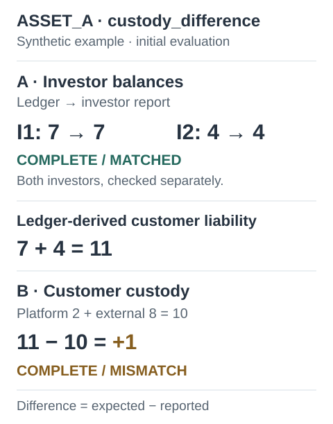
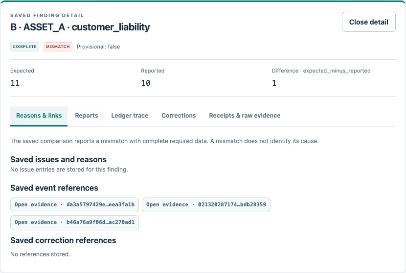

# crypto-reconciliation-lab

Ümit Bora Günaydın'ın kişisel projesi

Bu projeyi, kayıtlar geç geldiğinde veya bir değerlendirmeden sonra düzeltildiğinde mutabakatın nasıl ele alınacağını incelemek için geliştirdim. Sentetik işlem defteri, yatırımcı ve saklama verileri kullanıyor; önceki bulguları daha sonra incelenebilir biçimde koruyor.

Python **3.12+** · Paket **0.11.1** · Finansal kural `stage2-v2` · SQLite şema `6`

[Örnek](#örnek) · [Yerelde çalıştırma](#yerelde-çalıştırma) · [Beş dakikalık inceleme](five-minute-project-review.md) · [Kanıtlar](#doğrulama) · [English](../../README.md)

## Neden geliştirdim?

Miktarlar arasındaki fark, bir mutabakat sonucunun yalnızca bir parçası. Geç gelen kayıtların, eksik teslimatların ve geçmişe yönelik düzeltmelerin eldeki veriden çıkarılabilecek sonuçları nasıl değiştirdiğini görmek istedim. Bu durumları müşteri verisi veya kurum erişimi olmadan inceleyebilmek için uygulamayı yerel ve sentetik tuttum.

## Örnek

`custody_difference / initial / ASSET_A` örneğinde **A karşılaştırması**, iki yatırımcının bildirilen bakiyelerini işlem defteriyle eşleştiriyor: **I1 = 7, I2 = 4**. Defterden hesaplanan toplam müşteri yükümlülüğü **11**. **B karşılaştırmasında** ise müşteriler adına platformda **2**, dış saklamacıda **8** bulunuyor: toplam **10**. Gerekli girdiler tam olduğunda B sonucu `COMPLETE / MISMATCH`; beklenen eksi bildirilen miktar **+1**.



Bu +1, incelenmesi gereken bir uyuşmazlık. Tek başına nedenini açıklamıyor; kayıp veya iflas kanıtı oluşturmuyor. B, **işlem defterinden hesaplanan bakiyeleri** kullanıyor; yatırımcı raporlarının eşleşmesi bu hesabın yerine geçmiyor. Varlıklar birbirinin farkını kapatmıyor. Platformun müşteriler adına sakladığı varlıklar da platformun öz varlıklarından ayrı tutuluyor.

Eksik bilgi olduğunda sonuç değişiyor. `late_event` örneğinde teslimat manifestosu eksik bir çekim kaydını gösteriyor: görülen **12'ye karşı 11** farkı `INCOMPLETE / NOT_EVALUATED` olarak kalıyor. Çekim öğrenildiğinde yeni değerlendirme **11'e karşı 11**, yani `COMPLETE / MATCHED` veriyor. Önceki sonuç korunuyor.

### Kayıtlı bulguyu incelemek



Bu, aynı korunmuş finansal örneği gösteren gerçek bir **0.6.1 tarihsel ekran görüntüsü**; yeni bir 0.11.1 çekimi değil. [Çekim kaydı](../showcase/assets-manifest.json), kaynağını ve ayarlarını belirtiyor. Diyagram bu örneği açıklıyor; daha sonra eklenen bütün özelliklerin mimarisini temsil etmiyor.

## Sistem nasıl çalışıyor?

Finansal hesaplamayı, teslimat kabulünü ve kanıtların desteklediği iddiaları ayrı tuttum:

| Yetenek | Karar ve sözleşme |
|---|---|
| Kesin miktarlar ve zaman seçimi | `Decimal`, varlığa özgü hassasiyet ve sıfır tolerans; uygun kayıtları ekonomik zaman ve bilgi zamanı seçiyor. [Model](../model_contract.md) |
| Düzeltmeler ve geçmiş | Özgün ekonomik sırada tam `VOID` veya yalnız miktarı değiştiren `REPLACE`; raporlar kendi sürümlerini koruyor. [Anlamı](../correction_semantics.md) |
| Yeniden teslim ve kesinti | Sonlu JSONL teslimatı, kalıcı deneme geçmişi ve tekrarlar; ACK bir finansal sonuç değil. [Veri kabulü](../stage9/admission-contract.md) |
| İsteğe bağlı imzalı kabul | Kabul edilen baytları yerel politikaya göre yayıncı anahtarına bağlama; yetki iptali yeni etkileri sınırlar. [Yetki sınırı](../stage10/admission.md) |
| Kayıtlı execution bağlamı | Hesaplama sırasında gözlenen girdileri ve kabul bağlamını saklama; eski, kaydedilmemiş bağlam `NOT_RECORDED` kalır. [Execution](../stage12/execution-contract.md) |
| Çevrimdışı inceleme | Bakiyeleri tekrar hesaplamadan kayıtlı bulguları okuma ve kanıtlarına ilerleme. [Kaynak izi](../stage11/provenance-contract.md) |
| Finansal replay | İki dışa aktarılmış dosyadan yeniden hesaplama, tam sonucu karşılaştırma ve ayrıca seçilmiş execution kimliği isteme. [Replay](../stage13/replay-contract.md) |

`occurred_at` ekonomik olayın zamanı, `received_at` kaydın öğrenildiği zaman. `balance_at` karşılaştırılan bakiye anını, `knowledge_at` ise değerlendirmede kullanılabilecek bilginin sınırını belirtiyor. Farklı bakiye anları aynı anmış gibi karşılaştırılmıyor. Kesin finansal sonuçtan önce gerekli veri kapsamının tamlığı kontrol ediliyor.

## Yerelde çalıştırma

Python 3.12+ ile proje kökünden aşağıdaki mevcut komutları çalıştırın. İki çıktı dizini de yeni olmalı:

```sh
python3 scripts/reproduce_review.py --output review-final-new
python3 -m crypto_reconciliation_lab demo-execution-replay --output replay-final-new
```

Önce `review-final-new/index.md`, ardından `review-final-new/review/bundle/index.html` dosyasını açın. İlk komut **9 senaryo / 24 kayıtlı değerlendirme**, çevrimdışı inceleme ekranı ve mevcut JSON modeliyle sınırlı puanlama üretiyor. API anahtarı veya isteğe bağlı AI/auth paketleri gerekmiyor. Donmuş ana deneyin verisini yeniden üretmiyor, modelini eğitmiyor ve final holdout değerlendirmesini açmıyor. Beklenen finansal uyuşmazlıklar uygulama hatası değil; komut kendi kontrolleri geçtiğinde 0 ile çıkıyor.

**Yedi sabit replay vakası** için `replay-final-new/summary.md` dosyasını okuyun. Doğru biçimde yeniden üretilen finansal uyuşmazlık `REPRODUCED / 0`; hash bağları tutarlı biçimde yeniden hesaplanmış yanlış cevap `DIVERGED / 1`; yanlış dış kimlik `ERROR / 2` veriyor. Demo komutunun kendisi, bütün vakalar beklenen sonuçları verdiğinde 0 ile çıkıyor.

[Beş dakikalık inceleme rotası](five-minute-project-review.md), bu çıktıları, gerçek ekran kontrollerini ve iki replay girdi dosyasını bir araya getiriyor. Viewer kayıtlı cevabı okuyor; replay mevcut motorla tekrar hesaplıyor. Beş dakika bir okuma hedefi; kurulum veya CI süresi taahhüdü değil.

## Doğrulama

**15 Kasım 2026** tarihli uygulama başlangıcı, [b2df4f1 commit'i](https://github.com/umitbora55/crypto-reconciliation-lab/commit/b2df4f13eb7e2fc6b048f17eaaa24f02bf0bd29e) ve ona ait [main CI koşusu 43741674664](https://github.com/umitbora55/crypto-reconciliation-lab/actions/runs/43741674664) ile sabit. Beş iş de başarılı. Bu tarihli kanıt, daha sonra yapılan dokümantasyon commit'inin CI sonucu olarak sunulmuyor.

| O koşudaki kapsam | Sonuç |
|---|---|
| Full Python 3.12 ve 3.14 | Kaynak ve izole kurulum suite'lerinin her birinde **875** beklenen = keşfedilen = yürütülen benzersiz test kimliği; skip, xfail, failure ve error sıfır |
| Full Python 3.14 finansal kontrolü | **69 vaka / 162 değerlendirme**; on hata sayacı sıfır; **325 + 12 + 36 = 373** referans dosyası eşit |
| Core / auth-only Python 3.14 | Profil kontrolleri geçti; core'da AI/auth crypto, auth-only'de AI yok; tam suite'ler `NOT_RUN` |
| Diğer finansal matris hücreleri | `NOT_RUN` |

Kapanışta dört özgün artifact ZIP'i ve beş iş günlüğü denetlendi. Finansal kanıt, kayıtlı fingerprint'leri ve gerçek komut sonuçlarını içeriyor; kompakt arşivlerde 373 ham raporun tamamı bulunmuyor. Ayrıntılar için [workflow](https://github.com/umitbora55/crypto-reconciliation-lab/actions/workflows/release.yml), [dağıtım rehberi](../stage6_1/release-guide.md) ve [replay onarım sözleşmesi](repair-contract.md) okunabilir.

## AI deneyi

Çözülmemiş sentetik vakaları inceleme sırasına koymak için sabit bir modeli FIFO ve basit kurallarla karşılaştırdım. Tarihsel recall ölçümünde model eksi kurallar farkı test kümesinde **0 yüzde puan**, challenge kümesinde **−2,083 yüzde puan** oldu. Model üstünlüğü gösterilmedi.

[Değerlendirme](../stage6/evidence/stage5-evaluation.md) ve [model kartı](../stage6/evidence/stage5-model_card.md) bu sonucu koruyor. Sıralama bakiyeleri veya mutabakat sonuçlarını değiştirmiyor. Küçük JSON-model replay'i yeni bir başarı metriği üretmiyor ve holdout değerlendirmesini tekrarlamıyor.

## Sınırlar

Replay mevcut finansal motorla yeniden üretim yapıyor; bağımsız bir algoritma değil. Özgün çalıştırılabilir yazılım kimliği `NOT_RECORDED`. Kaynak imzaları veya özgün veritabanının haricen tamlığı replay tarafından yeniden kanıtlanmıyor. Beklenen execution kimliği operatörün seçtiği bir pin; kendiliğinden güvenilir kurum kimliği oluşturmuyor.

İmzalı kabul, bir anahtarı yerel politikaya göre yetkilendiriyor. Gerçek kurum kimliğini, bildirilen miktarın doğruluğunu veya mevzuat uyumunu kanıtlamıyor. Gerçek süreç sonlandırma kontrolleri belirli yerel transaction sınırlarını kapsıyor; disk/güç kaybı garantisi, üretim kapasitesi veya SLA iddiası taşımıyor.

Bu sentetik bir referans proje; resmî KVMKS istemcisi veya canlı kurum entegrasyonu değil. Güncel bir kurum eksiğinin kanıtı olarak sunulmuyor. [Kaynak kaydı](../problem_evidence.md), belgelenmiş kavramları tasarım varsayımlarından ayırıyor.

[MIT lisansı](../../LICENSE) · [English README](../../README.md) · [Tarihsel 0.6.1 sunumu](../showcase/README.tr.md)
