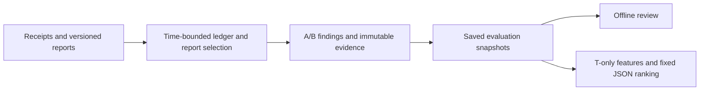

# Five-minute engineering review

This project asks whether three records agree: the event ledger, investor balance
reports, and assets held for customers. It is a synthetic engineering reference,
not an official institutional client or a production/compliance claim. The
financial rule remains `stage2-v2`, SQLite schema 3, and the existing v1 contracts.

## 1. Produce a small review

From the source distribution or clean source directory, using Python 3.12 or later:

```sh
python scripts/reproduce_review.py --output review-new
```

The destination must not exist. Open `review-new/index.md`, then
`review-new/review/bundle/index.html` directly in a browser. The output includes
nine existing demo scenarios and 24 saved evaluations, a second export of the
same selected snapshots, and a small fixed JSON-model ranking. After installation,
these operations need no network or API key. Dependency installation and isolated
package building may download packages.

The script records actual subprocess commands, import origins, exits and hashes.
Use `--mode installed --python /absolute/path/to/venv/bin/python` when checking an
installed wheel: its subprocesses run outside the source tree with `-I`. The
[source script](../../scripts/reproduce_review.py) explains both modes.

## 2. Read the two financial comparisons

A checks each ledger-derived investor balance against the platform's report.
B checks total ledger-derived customer liabilities against customer assets held
at the platform plus the external custodian. The platform's own assets are outside
this model. Each asset is reconciled independently with exact Decimal quantities.

In `custody_difference`, ASSET_A investor balances match while custody is short
by one synthetic unit: expected minus reported is **+1**. This is a successful
example of detecting the injected discrepancy, not an application failure.
`late_event` first shows `INCOMPLETE / NOT_EVALUATED`, then a new matching snapshot
when the missing event becomes known. It does not infer a definitive shortage
from incomplete evidence. Open a finding and follow its report, receipt and trace
references; the [model contract](../model_contract.md) defines these boundaries.

## 3. Follow time and corrections

`occurred_at` locates an economic event; `received_at` records when it was learned.
`balance_at` identifies the balance being compared and `knowledge_at` limits the
information available to an evaluation. A later receipt creates a new evaluation;
it does not rewrite the old result. Economic ordering, not delivery order,
determines running balances.

An event correction and a balance-report revision are separate records. A corrected
ledger may still disagree with an older investor or custody report until that
report's own revision arrives. The offline viewer compares compatible saved
snapshots and displays their original evidence rather than recomputing history.



## 4. Check the measured tradeoff

The historical 0.3.2-to-0.3.3 experiment added one receipt-hash index. In P2
(10,000 events, 20 investors), median reconciliation plus persistence fell from
**4.725224 to 1.052749 seconds (77.72%)**. Median ingest rose from **4.709168 to
4.955826 seconds (5.24%)**. There were only three normal observations per variant;
P3's financial-phase total increased 8.48%, and full-process delays prevented a
dependable end-to-end speedup claim. These are old measurements under the recorded
macOS/Python/SQLite conditions, not new 0.6.0 benchmarks. Read the
[unchanged interpretation](evidence/stage3_3-performance_interpretation.md).

## 5. Inspect the model result and the repaired boundaries

The historical 0.5.0 fixed model added **0 percentage points** over rules on test
and **−2.083 percentage points** on challenge. Identical observed histories can
have different future outcomes. Scores prioritize a synthetic review queue; they
are not calibrated financial risk and never alter findings. The small example
uses selected historical T-only units and the existing model, with provenance in
[its selection manifest](../../examples/triage-review/selection-manifest.json).
It contains no future labels and produces no new success metric. See the
[historical evaluation](evidence/stage5-evaluation.md) and
[model card](evidence/stage5-model_card.md).

Three maintenance failures show why boundaries matter:

- **F1:** caller Decimal precision rounded long absolute values/sort keys before
  feature formatting; context-independent sign operations repaired the problem.
- **F2:** a source at H could hide behind a summary at T; each source time, true
  maximum and supplied reference/snapshot link is now checked. The included
  negative example must exit 2 without publishing a successful queue.
- **F3:** a self-consistent partial feature/queue set could pass a full experiment
  gate; freeze/final evaluation now requires the independent public episode×asset
  inventory, including closed units, and exact final label coverage.

The [claim–evidence table](claim-evidence.md) separates historical measurements
from local release checks. [CI notes](ci.md) describe the prepared Ubuntu jobs;
remote CI remains **NOT_RUN**. Full experiment generation, training and final
holdout evaluation are deliberately absent from this small review.
