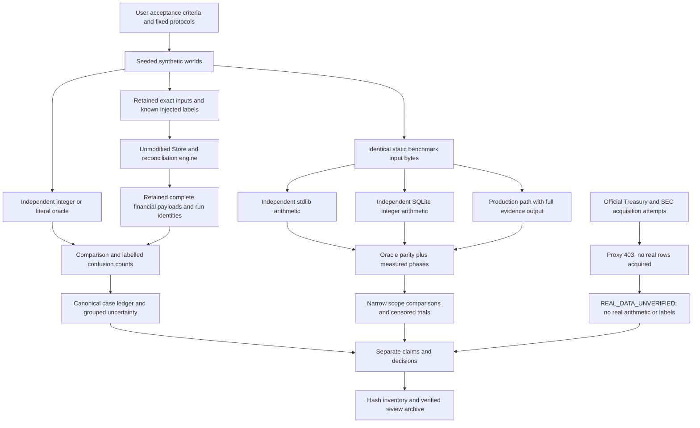

# Data, labels and evidence lineage

Synthetic labels are outside the application and are not passed into its decisions. Shared family controls and multiple cases from one seed/factor world are dependent; they are not independent institutional observations. The SQL and stdlib benchmark arithmetic implementations are separate, but share an explicitly disclosed narrow input validator and persistence helper. Production replay uses the current engine and is not an independent financial oracle.

No arrow converts unavailable official data into a synthetic real-data substitute. The four transferability classes and missing institutional truth are defined in [real_world_transferability.md](real_world_transferability.md). Hash inventories bind retained bytes; they do not create an external authority for the truth of those bytes.
